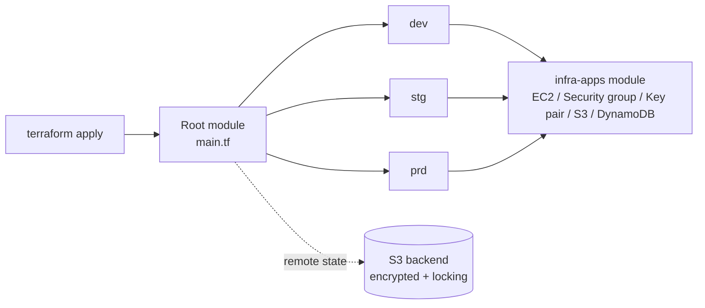
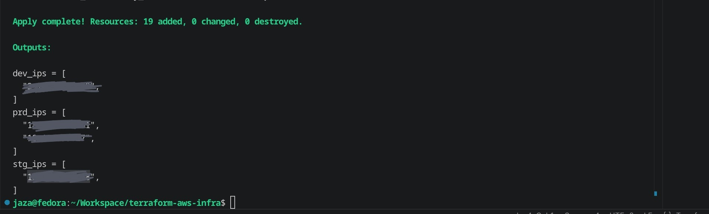
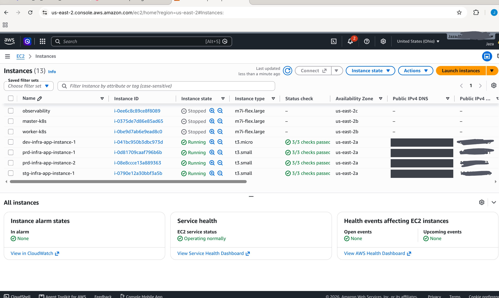
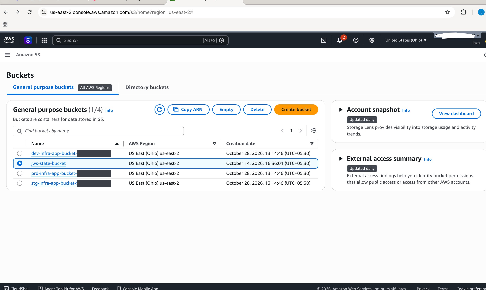
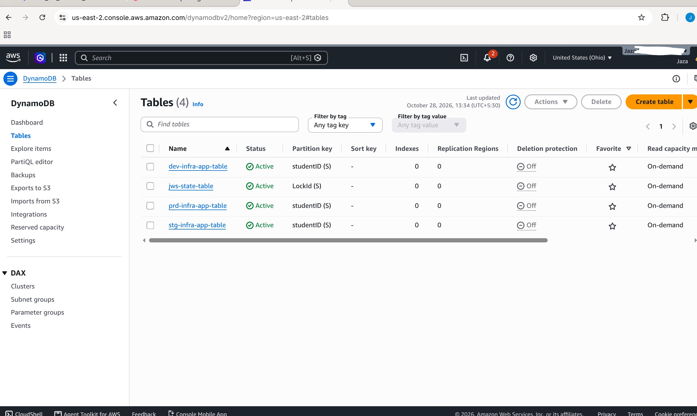

# Terraform AWS Multi-Environment Infrastructure

Infrastructure as Code project that provisions **dev**, **staging** and **production** environments on AWS from a single reusable Terraform module. Every environment gets the same set of resources, and only the inputs (instance count, instance type, disk size) change. Terraform state is stored remotely in an encrypted S3 bucket with state locking.


## Why this project

Creating servers and storage by hand in the AWS console is slow and hard to repeat. This project describes the whole setup as code, so that:

- three environments can be created, changed and destroyed with the same commands
- every environment is built the same way, so dev behaves like production
- changes are reviewed in `terraform plan` before anything is touched
- state is shared and protected from concurrent runs instead of living on one laptop

## Architecture



`main.tf` calls the `infra-apps` module three times with different inputs:

| Environment | Instances | Instance type | Root disk |
|---|---|---|---|
| dev | 1 | t3.micro | 10 GB gp3 |
| stg | 1 | t3.small | 10 GB gp3 |
| prd | 2 | t3.small | 20 GB gp3 |

### Resources created per environment

| Resource | Details |
|---|---|
| EC2 instances | Ubuntu 24.04 (latest Canonical AMI, found with a data source), count set per environment |
| Key pair | `<env>-infra-app-key`, built from your public SSH key |
| Security group | SSH (22) allowed only from your IP, HTTP (80) open, all outbound allowed |
| S3 bucket | `<env>-infra-app-bucket-<account-id>` with all public access blocked |
| DynamoDB table | `<env>-infra-app-table`, on-demand billing, `studentID` as the partition key |

A full apply creates **19 resources** across the three environments.

## Project structure

```
terraform-aws-infra/
├── main.tf                    # Calls the module for dev, stg and prd
├── providers.tf               # AWS provider and region
├── terraform.tf               # Terraform/provider versions and S3 backend
├── variables.tf               # Root variables (region, your IP)
├── outputs.tf                 # Public IPs per environment
├── terraform.tfvars.example   # Example input values
├── ec2-key.pub          # Public SSH key (the private key is never committed)
└── infra-apps/                # Reusable module
    ├── ec2.tf                 # AMI lookup, key pair, security group, instances
    ├── s3.tf                  # S3 bucket and public access block
    ├── dynamodb.tf            # DynamoDB table
    ├── variables.tf           # Module inputs
    └── outputs.tf             # Instance IPs, bucket name, table name
```

## Prerequisites

- [Terraform](https://developer.hashicorp.com/terraform/install) 1.10 or newer
- [AWS CLI](https://docs.aws.amazon.com/cli/latest/userguide/getting-started-install.html) configured with an IAM user (`aws configure`)
- An SSH key pair (generated in step 1 below)

## Usage

**1. Generate an SSH key**

```bash
ssh-keygen -t ed25519 -f ec2-key
```

This creates `ec2-key` (private, never commit it) and `ec2-key.pub` (public).

**2. Create the remote state bucket (once, by hand)**

Terraform can't store its state in a bucket that doesn't exist yet.

```bash
aws s3api create-bucket --bucket <your-unique-name>-tfstate --region <your-region> \
  --create-bucket-configuration LocationConstraint=<your-region>
aws s3api put-bucket-versioning --bucket <your-unique-name>-tfstate \
  --versioning-configuration Status=Enabled
```

Leave out `--create-bucket-configuration` if your region is `us-east-1`. Then set the same bucket name and region in the `backend "s3"` block of `terraform.tf`.

**3. Set your IP for SSH access**

```bash
cp terraform.tfvars.example terraform.tfvars
curl -4 ifconfig.me        # copy the result into terraform.tfvars as <ip>/32
```

**4. Deploy**

```bash
terraform init
terraform plan
terraform apply
```

**5. Connect to an instance**

```bash
terraform output
ssh -i ec2-key ubuntu@<ip-from-output>
```

**6. Clean up**

```bash
terraform destroy
```

Always destroy when you are finished. EC2 instances are billed while they run.

## Design decisions

- **Reusable module.** One module defines the environment, so a fix or improvement is made in one place and applies to dev, staging and production alike.
- **Remote state with locking.** The S3 backend uses `encrypt = true` and `use_lockfile = true` (native S3 locking), so two runs cannot change the state at the same time.
- **Least-privilege SSH.** Port 22 is limited to a single `/32` address supplied as a variable. Nothing is hardcoded in the code.
- **No hardcoded AMI.** A `aws_ami` data source finds the latest Ubuntu 24.04 image, so the code works in any region.
- **Safe S3 defaults.** Public access is blocked on every bucket, and the account ID in the name avoids global name clashes.
- **Secrets stay out of Git.** `.gitignore` excludes state files, `terraform.tfvars` and private keys.

## Screenshots

**`terraform apply` output: 19 resources created**



**EC2 instances for dev, stg and prd**



**S3 buckets (one per environment, plus the remote state bucket)**



**DynamoDB tables (one per environment, plus the state lock table from the earlier project)**



## Limitations and next steps

- The three environments share one state file. Separate state per environment (or Terraform workspaces) would isolate them better.
- Instances run in the default VPC. A custom VPC with public and private subnets would be closer to a production setup.
- Add a GitHub Actions workflow that runs `terraform fmt`, `validate` and `plan` on every pull request.

## Author

**Jaza Saifi**: [GitHub](https://github.com/JAZA800) | [LinkedIn](https://www.linkedin.com/in/jaza-saifi)
